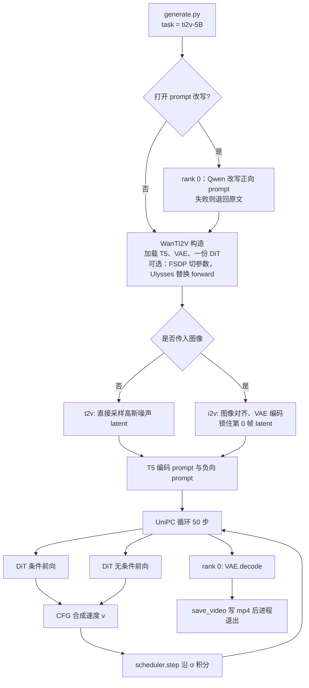

# Wan2.2 TI2V-5B 推理范围与 Pipeline

本文划定当前仓库里 **TI2V-5B**（`Wan2.2-TI2V-5B`，任务名 `ti2v-5B`）的推理实现边界，并按真实调用顺序说明 pipeline，以及这条链路上实际用到的优化。多卡切分见 [TI2V-5B 推理侧并行方式](ti2v_5b_parallelism.md)。论文推理侧的二维上下文并行、diffusion cache、FP8 GEMM 和 8-bit FlashAttention 没有进入本仓库，对照放在 [docs/problems](problems/)。范围按「最小可运行的文生视频推理」来划：单次生成一条视频，不包含服务化、作业调度和 A14B / S2V / Animate。

对应课题里的第一步：先认清推理过程中的主要算子、计算、访存和并行特征，再谈 SME ARM 众核上的适配。本文描述的是 **GPU 参考实现**，不是 ARM 实现。

## 1. 范围结论

TI2V-5B 在本仓库中是一条 **单进程、单次请求** 的推理链路，由三个模型串起来：

1. **umT5-XXL 编码器**：每个请求跑 2 次（正向 prompt 与负向 prompt），得到文本条件。
2. **Wan DiT（约 5B，单份权重）**：去噪循环的主体。默认 50 步、classifier-free guidance，每步 2 次前向，共约 100 次 DiT 前向。
3. **Wan2.2 VAE 解码器**：去噪结束后在 rank 0 跑 1 次，把 latent 还原成像素视频。图生视频才会额外跑 1 次 VAE 编码。

和 A14B 的差别直接影响迁移范围：

- 只有 **一个** DiT。没有 `low_noise_model` / `high_noise_model` 两套专家，也没有按时间步切换模型。
- VAE 使用 `wan/modules/vae2_2.py` 的 `Wan2_2_VAE`，压缩步长是时间 4、空间 16（`vae_stride = (4, 16, 16)`），latent 通道 `z_dim = 48`。
- 权重用 `WanModel.from_pretrained(checkpoint_dir)` 从检查点根目录加载，不进子目录。

仓库里没有常驻服务、请求队列、Slurm 脚本，也没有 SME / ARM 后端。这条链路里真正改变计算或显存的手段是：单卡上的 CPU offload 与 bfloat16，多卡上可选的 FSDP（切参数）和一维 Ulysses（切序列）。精度停在 bf16 的 GEMM 和 FlashAttention；50 步里条件前向和无条件前向都不跳过。可选的 prompt 改写只换送进 umT5 的正向字符串，不改变这 100 次前向，见 [TI2V-5B 的 Prompt 改写](ti2v_prompt_alignment.md)。汇总见第 5.10 节。

多卡两项默认都关闭，共用同一个 NCCL 进程组，作用在同一次生成上，不增加采样步，也不把 batch 拆开。最小实现可以整段不走。切分粒度见 [TI2V-5B 推理侧并行方式](ti2v_5b_parallelism.md)，进入 pipeline 的位置见第 5.3 节。

## 2. 仓库内的文件范围

### 2.1 最小推理必须经过的代码

| 角色 | 路径 | 在 TI2V 中做什么 |
| --- | --- | --- |
| 命令入口 | `generate.py` | 解析参数、按 `WORLD_SIZE` 决定是否初始化 NCCL、构造 `WanTI2V`、保存 mp4、退出 |
| 管道 | `wan/textimage2video.py` | `WanTI2V`：加载三个模型，实现 `t2v()` 与 `i2v()` |
| 任务配置 | `wan/configs/wan_ti2v_5B.py` | 分辨率步长、DiT 宽度、采样默认值 |
| 共享配置 | `wan/configs/shared_config.py` | T5 dtype、文本长度 512、DiT 参数 dtype、负向 prompt、训练步数 1000 |
| 任务注册 | `wan/configs/__init__.py` | `ti2v-5B` 注册项；合法分辨率只有 `1280*704` 与 `704*1280` |
| DiT | `wan/modules/model.py` | Patch 嵌入、30 层 Transformer、时间调制、RoPE、反 patch |
| 注意力封装 | `wan/modules/attention.py` | DiT 实际调用的是 `flash_attention()`，要求 CUDA |
| 文本编码器 | `wan/modules/t5.py` | umT5-XXL encoder-only，注意力用 `einsum`，不走 FlashAttention |
| 分词 | `wan/modules/tokenizers.py` | Hugging Face tokenizer 包装，序列长度截断到 512 |
| VAE | `wan/modules/vae2_2.py` | 3D 因果卷积 VAE，编码（仅 i2v）与解码 |
| 默认采样器 | `wan/utils/fm_solvers_unipc.py` | Rectified flow 的 UniPC 积分，默认 `sample_solver=unipc` |
| 可选采样器 | `wan/utils/fm_solvers.py` | 同一条 flow ODE 的 `dpm++`，与 UniPC 二选一 |
| 张量与写盘 | `wan/utils/utils.py` | `masks_like`、`best_output_size`、`save_video` |

导出入口在 `wan/__init__.py` 的 `WanTI2V`。两个调度器如何把 DiT 输出当成速度、沿 σ 从噪声积到数据，见 [Wan2.2 中的 Rectified Flow](wan22_rectified_flow.md)。

### 2.2 最小实现可以不碰的代码

这些文件能被同一条 `generate.py` 命令带上，但不在 TI2V 计算热路径上。

| 路径 | 原因 |
| --- | --- |
| `wan/distributed/fsdp.py` | 仅 `--dit_fsdp` / `--t5_fsdp` 时把参数切到多卡 |
| `wan/distributed/ulysses.py` | 仅 `--ulysses_size > 1` 时替换注意力 |
| `wan/distributed/sequence_parallel.py` | 同上，替换 DiT `forward`，按序列维切分 |
| `wan/distributed/util.py` | 进程组与 all-to-all |
| `wan/utils/prompt_extend.py`、`wan/utils/system_prompt.py` | `--use_prompt_extend` 才在采样前改写正向 prompt。见 [TI2V-5B 的 Prompt 改写](ti2v_prompt_alignment.md) |

这些文件在单卡最小路径上不会被调用。多卡时它们不改变第 5 节的采样循环：FSDP 在 `WanTI2V` 构造时按 block 切参数，Ulysses 在进循环前替换 DiT 的 `forward` 和每层自注意力。`--ulysses_size` 必须等于 `WORLD_SIZE`，且 `num_heads = 24` 必须能被卡数整除。这是 GPU 多卡策略，与 ARM 众核上要新做的线程并行是两件事。用法见 [TI2V-5B 推理侧并行方式](ti2v_5b_parallelism.md)。

### 2.3 不属于 TI2V-5B 的代码

做 5B 最小负载时不要把这些算进迁移范围：

- A14B 双专家管道：`wan/text2video.py`、`wan/image2video.py`，以及 `wan/configs/wan_t2v_A14B.py`、`wan/configs/wan_i2v_A14B.py`
- 旧 VAE：`wan/modules/vae2_1.py`（A14B 用，压缩是 4×8×8，通道与 2.2 VAE 不同）
- 语音与角色动画：`wan/speech2video.py`、`wan/animate.py`、`wan/modules/s2v/`、`wan/modules/animate/`
- `requirements_s2v.txt`、`requirements_animate.txt`

## 3. 权重与配置

权重不在仓库里。下载后 `--ckpt_dir` 指向该目录：

```bash
modelscope download Wan-AI/Wan2.2-TI2V-5B --local_dir ./Wan2.2-TI2V-5B
```

`WanTI2V.__init__` 按配置取下面三个文件（或目录）：

| 配置项 | 默认相对路径 | 加载方 |
| --- | --- | --- |
| `t5_checkpoint` | `models_t5_umt5-xxl-enc-bf16.pth` | `T5EncoderModel` |
| `t5_tokenizer` | `google/umt5-xxl` | `HuggingfaceTokenizer` |
| `vae_checkpoint` | `Wan2.2_VAE.pth` | `Wan2_2_VAE` |
| DiT | 检查点根目录（`from_pretrained(checkpoint_dir)`） | `WanModel` |

DiT 的 `in_dim`、`out_dim`、`text_dim` 写在权重自带的模型配置里，由 `from_pretrained` 读入。仓库 Python 配置没有覆盖这三项。VAE 侧通道数在代码里固定为 `z_dim = 48`，umT5 隐藏维在 `umt5_xxl()` 里固定为 4096。权重里的 DiT 配置必须与这两处对齐。

`wan/configs/wan_ti2v_5B.py` 与 `shared_config.py` 中、迁移时需要钉死的超参：

| 项 | 值 | 含义 |
| --- | --- | --- |
| `dim` | 3072 | DiT 隐藏维 |
| `ffn_dim` | 14336 | FFN 中间维 |
| `num_heads` | 24 | head 数，head 维 = 128 |
| `num_layers` | 30 | Transformer 层数 |
| `freq_dim` | 256 | 时间正弦编码维 |
| `patch_size` | `(1, 2, 2)` | 时间不切，空间 2×2 |
| `vae_stride` | `(4, 16, 16)` | latent 相对像素的 (T, H, W) 步长 |
| `text_len` | 512 | 文本 token 上限 |
| `param_dtype` / `t5_dtype` | bfloat16 | DiT 与 T5 计算 dtype；若干归一化与调制在 fp32 |
| `sample_steps` | 50 | 默认去噪步数 |
| `sample_shift` | 5.0 | 把均匀的 flow 时间拧向高噪声；公式见 [Wan2.2 中的 Rectified Flow](wan22_rectified_flow.md) |
| `sample_guide_scale` | 5.0 | CFG 强度，作用在速度 \(v\) 上；标量，不是 A14B 那种双值 |
| `frame_num` | 121 | 默认帧数，须满足 `4n+1` |
| `sample_fps` | 24 | 写 mp4 的帧率，不参与网络计算 |
| `num_train_timesteps` | 1000 | 把 σ∈[0,1] 放大成 DiT 的整数时间步 |
| `window_size` | `(-1, -1)` | 自注意力是全局注意力 |

umT5-XXL encoder（`wan/modules/t5.py` 的 `umt5_xxl`，`encoder_only=True`）：词表 256384，隐藏维 4096，FFN 10240，64 head（head 维 64），24 层，相对位置桶 32。Decoder 不参与推理。

VAE（`Wan2_2_VAE`）：`z_dim=48`，编码器基宽 `c_dim=160`，解码器基宽在 `WanVAE_` 中为 `dec_dim=256`，`dim_mult=[1, 2, 4, 4]`，每级 2 个残差块，`attn_scales=[]`（这条 VAE 路径没有空间注意力），时间下采样标记 `[False, True, True]`。权重 dtype 默认 fp32。通道均值和标准差写在 `Wan2_2_VAE.__init__` 里，编码后做 `(mu - mean) * (1/std)`，解码前做逆变换。

## 4. 默认一次文生视频的张量规模

下面按默认文生视频计算：`1280*704`、121 帧、单卡（`sp_size = 1`）。`704*1280` 的 token 数相同。这是后面算延迟和内存时的基准形状。

像素：`3 × 121 × 704 × 1280`。

VAE latent：

```text
T = (121 - 1) / 4 + 1 = 31
H = 704 / 16 = 44
W = 1280 / 16 = 80
形状 = [48, 31, 44, 80]
```

DiT patch（`stride = (1, 2, 2)`）之后：

```text
token 数 = 31 × (44 / 2) × (80 / 2) = 31 × 22 × 40 = 27280
每 token 隐藏维 = 3072
```

一次 DiT 前向里，自注意力的序列长度就是这 27280。交叉注意力的 query 同样是 27280，key/value 来自文本，长度不超过 512。

打开 Ulysses 后，这个 27280 会先补齐到进程数的倍数，再在前向内部按序列维切开。8 卡时每卡 3410 个 token，隐藏维仍是 3072；自注意力内部暂时拼回 27280，同时只保留 `24 / 8 = 3` 个 head。采样步数不因此改变。切分发生在第 5.3 节所说的那一次前向里，all-to-all 的形状见 [TI2V-5B 推理侧并行方式](ti2v_5b_parallelism.md)。下面的 pipeline 仍按单卡形状写每一步。

采样循环：

```text
DiT 前向次数 = sample_steps × 2 = 50 × 2 = 100
每层都含 1 次全局自注意力 + 1 次交叉注意力 + 1 次 FFN
层数 = 30
```

因此热路径是 **100 × 30 层 DiT block**，不是 T5，也不是 VAE。T5 每个请求 2 次，VAE 解码每个请求 1 次。本仓库不跳过采样步，也不把 GEMM 或注意力降到 FP8 / Int8，所以上面的次数就是实际计算量。

图生视频的空间尺寸不直接用 `--size` 的宽高，而是用 `max_area = 704×1280`，再由 `best_output_size` 把宽高对齐到 32 的倍数（`patch_size` 的空间维 × `vae_stride` 的空间维 = 32），并尽量保持原图宽高比。帧数公式与文生视频相同。

## 5. Pipeline

### 5.1 总流程



`generate()` 只做分发：有 `img` 走 `i2v()`，否则走 `t2v()`。两条路径的去噪循环同构，差别在 latent 初始化和第 0 帧是否被条件钉死。循环是 rectified flow 采样：DiT 预测速度，调度器把 σ 从高噪声积到 0。路径、换算和积分见 [Wan2.2 中的 Rectified Flow](wan22_rectified_flow.md)。

默认不改写 prompt，节点 P 直接进入构造。打开 `--use_prompt_extend` 时，节点 R 只替换正向字符串，负向 prompt 和后面的 50 步不变。改写模型、系统提示词和与论文三条原则的差别见 [TI2V-5B 的 Prompt 改写](ti2v_prompt_alignment.md)。

多卡不给这张图增加节点。FSDP 和 Ulysses 发生在节点 B 的构造，以及节点 H、I 每一次 DiT 前向的内部。从 G 到 K 的 50 步、每步两次前向，卡数变了也不变。见第 5.3 节。

进程模型是一次性的。`generate.py` 在 rank 0 把返回的 `(C, T, H, W)`、值域 `[-1, 1]` 的张量写成 mp4，然后 `barrier`，若分布式已初始化则 `destroy_process_group`，进程结束。模型不会留到下一条请求。

### 5.2 启动与设备

`generate.py` 读取 `RANK`、`WORLD_SIZE`、`LOCAL_RANK`。单进程时这三个变量缺省为 0、1、0，不初始化进程组，FSDP 与 Ulysses 会被直接拒绝。

多进程时：

```text
torch.cuda.set_device(local_rank)
dist.init_process_group(backend="nccl", init_method="env://")
```

`WanTI2V` 把计算设备写成 `cuda:{device_id}`。未显式指定 `--offload_model` 时，单进程默认为 `True`（模块在 CPU/GPU 之间来回搬），多进程默认为 `False`（权重留在 GPU）。

单卡省显存的参考命令（README：约 24GB 显存）：

```bash
python generate.py --task ti2v-5B --size 1280*704 \
  --ckpt_dir ./Wan2.2-TI2V-5B \
  --offload_model True --convert_model_dtype --t5_cpu \
  --prompt "..."
```

`--t5_cpu` 让 T5 始终在 CPU 上编码，再把 embedding 拷到计算设备。`--convert_model_dtype` 只在不用 FSDP 时把 DiT 参数转成 `param_dtype`（bfloat16）。上面这条命令不建进程组。多卡时进程组上多出来的是两处包装：构造期可以按层切开权重，前向可以换成序列并行版本。第 5.1 节从采样到写盘的步数保持不变。

### 5.3 多卡并行嵌在构造和一次前向里

第 5.2 节的进程组建好之后，FSDP 和 Ulysses 在下面两个时刻生效。第 5.4 节起的文本编码、去噪和写盘仍按单卡的调用顺序进行。

构造 `WanTI2V` 时（流程图的加载节点）：

- `--t5_fsdp`：T5 权重加载完就交给 `wan/distributed/fsdp.py` 的 `shard_model`，按 24 层 `T5SelfAttention` 切开。后面的两次编码仍是每个请求各跑一遍，参数按 rank 分片，进层时再 all-gather。
- `--dit_fsdp`：DiT `from_pretrained` 之后，在 `_configure_model` 里按 30 个 `WanAttentionBlock` 切开。patch 嵌入、时间嵌入、文本嵌入和 head 留在根上的 FSDP 单元。VAE 不切，每张卡各放一份。
- `--ulysses_size > 1`：同一处先把 `WanModel.forward` 换成 `sp_dit_forward`，把每层自注意力换成 `sp_attn_forward`，再包 FSDP。采样循环看见的仍是 `self.model(...)`。

两个开关可以单独打开。Ulysses 的规模必须等于进程数，并且 24 个 head 能被这个数整除。FSDP 与 Ulysses 共用 `generate.py` 建好的那一个 NCCL 进程组，没有再拆出第二个组。进程组里还有三件与切分配套、本身不切张量的事：广播 seed，使各卡切的是同一条序列；prompt 扩展只在 rank 0 做完再广播；`vae.decode` 和写 mp4 只在 rank 0。`i2v()` 的 `vae.encode` 则在每个 rank 上各跑一次。

序列要到第 5.7 节那一次 DiT 前向里才切开。构造阶段只决定 `forward` 换成哪一个函数、权重按哪一层包进 FSDP。隐藏维 3072 在两种开关下都保持完整。

默认单卡命令不进入这些分支。8 卡同时打开 `--dit_fsdp --t5_fsdp --ulysses_size 8` 时，每卡 3410 个 token，自注意力时每卡 3 个 head。这是一维 Ulysses，不是论文推理侧的外层 RingAttention、内层 Ulysses。包裹策略、每次前向的通信和四种合法组合见 [TI2V-5B 推理侧并行方式](ti2v_5b_parallelism.md)。和论文的差异见 [推理侧二维上下文并行没有进入本仓库](problems/inference_parallelism.md)。

### 5.4 文本条件

每个请求编码两次：正向 prompt，以及负向 prompt。负向 prompt 为空时使用 `shared_config.py` 里的中文默认串，不参与改写。正向 prompt 默认就是用户原文；只有打开 `--use_prompt_extend` 时，这里拿到的才是第 5.1 节节点 R 改写后的字符串。见 [TI2V-5B 的 Prompt 改写](ti2v_prompt_alignment.md)。

`T5EncoderModel.__call__`：

1. tokenizer 清洗空白、截断或填充到最多 512。
2. `T5Encoder` 做 token embedding。`shared_pos=False`，相对位置偏差在每层内部计算。
3. 24 层 `T5SelfAttention`：LayerNorm、无缩放的 `einsum` 注意力、softmax 在 fp32、门控 GELU 的 FFN。
4. 按 mask 去掉 padding，返回变长 `List[Tensor]`，每个元素形状 `[L, 4096]`，`L ≤ 512`。

DiT 内部还会把这段向量线性投到 3072，并在长度维补零到 512。T5 的序列很短，计算量相对 DiT 可以忽略，但它是 **纯 PyTorch 的 einsum 注意力**，没有 FlashAttention。迁到 ARM 时这条路径比 DiT 注意力更容易先跑通，不能代表视频 backbone 的性能。若开了 `--t5_fsdp`，这两次编码走已经切好的权重，计算次数不变；`--t5_cpu` 与 `--t5_fsdp` 不要一起用。

### 5.5 文生视频 `t2v()`

1. 由帧数和 `vae_stride` 算出 latent 形状 `[48, 31, 44, 80]`（默认 720p）。
2. `seq_len` 向上取整到 `sp_size` 的倍数。`sp_size` 在单卡是 1，打开 Ulysses 时等于进程数（第 5.3 节）。单卡的 `seq_len` 就是 27280。
3. 在计算设备上用 `torch.randn` 生成 fp32 噪声，作为初始 latent。列表长度是 1，也就是 batch = 1。
4. 构造调度器。默认 UniPC：`FlowUniPCMultistepScheduler(num_train_timesteps=1000, shift=1)`，再 `set_timesteps(50, shift=5.0)`。
5. `masks_like(..., zero=False)` 得到全 1 掩码。文生视频不锁定任何帧。
6. 若开启 offload，此时才把 DiT `.to(device)`。
7. 对每个时间步 `t`：
   - 把标量 `t` 铺到空间下采样后的网格 `[:, ::2, ::2]` 上，再补到 `seq_len`。文生视频下每个 token 的时间条件相同。
   - 条件前向：`model(latents, t, context, seq_len)`。
   - 无条件前向：同一 latent，换成负向 context。
   - `noise_pred = uncond + guide_scale * (cond - uncond)`，`guide_scale = 5`。这个张量是速度 \(v\)，CFG 做在速度上。
   - `scheduler.step` 用 \(x_0=x_\sigma-\sigma v\) 换成数据端点预测，再沿 σ 减小的方向积分一步。
8. offload 时把 DiT 搬回 CPU，再在 rank 0 调用 `vae.decode`。

初始 `torch.randn` 位于 σ 的高噪声端，σ = 0 是数据端点。传给 DiT 的整数 `t` 是 `σ × 1000`。默认 UniPC 的一阶更新与欧拉步 \(x_{\mathrm{next}}=x+(\sigma_{\mathrm{next}}-\sigma)\,v\) 相同，`solver_order=2` 在此之上做多步校正。注意力和 FFN 不包含这些公式。推导、shift，以及和论文里「从噪声积到数据」的时间方向如何对齐，见 [Wan2.2 中的 Rectified Flow](wan22_rectified_flow.md)。

整个去噪包在 `autocast('cuda', dtype=bfloat16)` 和 `torch.no_grad()` 里。模型是 FSDP 时，外面再套一层 `no_sync()`，用来跳过梯度同步；这里没有反传，数值不变。

循环不缓存。每一步都执行条件前向和无条件前向，没有隔几步跳过无条件分支，也没有把某一层的注意力输出留到下一步复用。论文 4.4.2 的 diffusion cache（attention cache 与 CFG cache，以及 FasterCache 式残差补偿）不在这条循环里，见 [Diffusion cache 没有进入本仓库的推理实现](problems/diffusion_cache.md)。

### 5.6 图生视频 `i2v()`

在 `t2v` 的循环之外多了条件注入：

1. 按 `max_area` 计算输出宽高，放大后中心裁剪，像素归一化到 `[-1, 1]`，张量形状 `[3, 1, H, W]`（时间维长度为 1）。
2. `vae.encode` 得到第 0 帧的 latent `z`。多卡时每个 rank 都编码同一张图，这一步不随 FSDP 或 Ulysses 拆开。
3. 采样噪声仍覆盖全部 `T × H × W`。`masks_like(..., zero=True)` 把 **第 0 个 latent 帧** 的 mask 置 0。
4. 每步更新后执行 `latent = (1 - mask) * z + mask * latent`，第 0 帧始终保持为编码图像，其余帧继续去噪。
5. 时间条件同样乘上这个 mask：第 0 帧 token 的 timestep 为 0，其余帧为当前 `t`。timestep 0 就是 flow 的数据端点 σ = 0，所以这一帧保持 VAE 编码，其余帧继续积分。见 [Wan2.2 中的 Rectified Flow](wan22_rectified_flow.md)。

最小实现建议先做 `t2v()`。`i2v()` 多一次 VAE 编码和逐帧 mask，算子集合与 `t2v` 相同。

### 5.7 DiT 一次前向

实现是 `wan/modules/model.py` 的 `WanModel.forward`。TI2V 不走 `model_type == 'i2v'` 的 `y` 通道拼接，图像条件已经写在 latent 和 timestep 里。

1. **Patch 嵌入**：`Conv3d(in_dim → 3072, kernel=stride=(1,2,2))`。输出展成 `[1, 27280, 3072]`，不足 `seq_len` 的位置补 0。同时记下网格 `(F, H, W) = (31, 22, 40)`。
2. **时间嵌入**：正弦编码到 256 维，两层 MLP（Linear + SiLU + Linear）得到 3072 维，再投影成 6 组调制向量。这一段强制 fp32。调制是 **按 token** 的，形状 `[1, seq_len, 6, 3072]`。
3. **文本嵌入**：`Linear(4096 → 3072) + GELU(tanh) + Linear(3072 → 3072)`，序列补到 512。
4. **30 层 `WanAttentionBlock`**，每层：
   - 用 6 组调制做自适应缩放和平移（fp32）。
   - 自注意力：Q/K/V 三个 `Linear(3072, 3072)`，Q/K 做 RMSNorm，3D RoPE，然后 `flash_attention`，再输出投影。
   - 交叉注意力：query 来自视频 token，key/value 来自文本 token，无 RoPE。
   - FFN：`Linear(3072 → 14336)`、`GELU(approximate='tanh')`、`Linear(14336 → 3072)`。
   - 残差相加也在 fp32 autocast 中完成。
5. **Head**：同样的调制 + `Linear`，输出每个 token 的 `out_dim × 1 × 2 × 2` 个通道。
6. **unpatchify**：`einsum` 把 token 还原成 `[48, 31, 44, 80]` 的 fp32 张量。形状与 latent 相同，数值是当前 σ 上的速度 \(v\)。调度器如何把它积回数据见 [Wan2.2 中的 Rectified Flow](wan22_rectified_flow.md)。

RoPE 把 head 维 128 拆成三段频率，分别作用在时间、高、宽网格上（`rope_params` 的三段长度）。这六步是单卡 `WanModel.forward` 的顺序，多卡时各 rank 仍按这个顺序算。打开 Ulysses 后，第 1–3 步先得到完整序列，从第 4 步起每个 rank 只持有自己的一段；自注意力改走 `sp_attn_forward`，交叉注意力和 FFN 留在这段局部序列上。只开 FSDP 时激活形状不变，变的是每层权重在进入该层时 all-gather 成完整矩阵。单卡 RoPE 用 `model.py` 的 `rope_apply`；序列并行时改用 `sequence_parallel.py`，每个 rank 取自己那一段频率。通信和包裹粒度见 [TI2V-5B 推理侧并行方式](ti2v_5b_parallelism.md)。

`flash_attention()` 有两处和 ARM 直接冲突：

- `assert q.device.type == 'cuda'`
- 调用 FlashAttention 2 或 3 的 `flash_attn_varlen_func`

同文件里的 `attention()` 可以退到 `scaled_dot_product_attention`，但 `WanSelfAttention` 和 `WanCrossAttention` **没有调用它**。迁 ARM 时要替换的是 `model.py` 这两处对 `flash_attention` 的调用，或者让 `flash_attention` 在非 CUDA 设备走可移植实现。变长 batch 在 TI2V 里名存实亡：batch 恒为 1，真实长度就是 27280，padding 只为了对齐 `sp_size`。

精度停在半精度，没有论文 4.4.3 的量化。`flash_attention` 只接受 fp16 和 bf16，默认 bf16；Q、K、V 在进 kernel 前被收成这个 dtype。装了 FlashAttention 3 就走 `flash_attn_interface.flash_attn_varlen_func`，否则走 FlashAttention 2 的同名函数，传下去的都是这块半精度张量。block 里的 `nn.Linear` 在外层 bf16 autocast 下做 GEMM。没有权重按张量、激活按 token 的 FP8 GEMM，也没有 Int8 的 `QK^T`、FP8 的 `PV` 和跨块 FP32 累加。对照见 [推理侧量化没有进入本仓库](problems/quantization.md)。

### 5.8 VAE

`Wan2_2_VAE.encode` / `decode` 对列表里的每个视频单独跑，外面包一层 fp32 autocast。解码结果 `clamp` 到 `[-1, 1]`。

`WanVAE_.encode`：先把空间 `patchify` 成 2×2，再按时间块送进 `Encoder3d`。第 1 块 1 帧，之后每块 4 帧。`CausalConv3d` 用 `feat_cache` 保存上一块的时间上下文，所以块与块之间不能打乱顺序。

`WanVAE_.decode`：按 latent 的时间维 **逐帧** 调用 `Decoder3d`，帧间依赖同一份 cache，最后 `unpatchify`。默认 31 个 latent 帧就是 31 次串行解码调用。

`CausalConv3d` 把时间 padding 全部放在过去一侧，前向时如果有 cache 就拼到时间维前面再做普通 `Conv3d`。这是 VAE 里数量最多的算子，也是时间维上的串行点。多卡不把这 31 次解码拆开：decode 只在 rank 0 上按时间顺序跑完。

### 5.9 写视频

只有 rank 0 拿到像素张量。`save_video` 把 `[-1, 1]` 线性映到 0–255，按 `sample_fps = 24` 写成 mp4。文件名默认带任务名、分辨率、`ulysses_size`、prompt 前 50 个字符和时间戳。

### 5.10 这条链路实际用上的优化

按第 5.1–5.9 节的调用顺序，可选优化如下。Prompt 改写只换正向文本；后面几行才改变显存或内核。论文推理侧另外三项没有接进 `WanTI2V`，所以默认仍是 100 次 DiT 前向、每次 30 层全量 block。

| 手段 | 出现位置 | 实际作用 |
| --- | --- | --- |
| Prompt 改写 | `generate.py`，`--use_prompt_extend`，默认关，在构造 `WanTI2V` 之前 | 只替换正向 prompt。不减少 100 次前向。见 [TI2V-5B 的 Prompt 改写](ti2v_prompt_alignment.md) |
| `--offload_model`、`--t5_cpu`、`--convert_model_dtype` | 单卡构造与采样前后搬权重。多进程默认不 offload | 省显存。不减少前向次数，也不改算子种类 |
| bfloat16 autocast | `t2v()` / `i2v()` 包住整个去噪循环 | DiT 的 `nn.Linear` 按 bf16 做 GEMM。调制、若干残差和 VAE 仍偏 fp32 |
| FlashAttention 2 或 3 | 每层自注意力和交叉注意力，`wan/modules/attention.py` | Q、K、V 收成 bf16 后调用现成的 `flash_attn_varlen_func` |
| FSDP | 构造期，`--dit_fsdp` / `--t5_fsdp`，默认关 | 按 block 切参数，进层时 all-gather。不切序列，不切隐藏维 |
| 一维 Ulysses | 构造期替换 `forward`，`--ulysses_size` 必须等于进程数，默认关 | 序列切开，自注意力里 all-to-all 换成一部分 head。没有外层 Ring |

论文里写过、本路径没有接上的优化：

| 论文中的手段 | 本仓库 |
| --- | --- |
| 二维上下文并行：外层 RingAttention，内层 Ulysses；14B 上接近线性加速 | 只有内层 Ulysses。见 [推理侧二维上下文并行没有进入本仓库](problems/inference_parallelism.md) |
| Diffusion cache：隔几步复用注意力输出，后段复用条件结果并做残差补偿；14B 文生视频约 1.62 倍 | 每步两次完整前向，每层注意力都重算。见 [Diffusion cache 没有进入本仓库的推理实现](problems/diffusion_cache.md) |
| FP8 GEMM，以及 Int8 的 `QK^T`、FP8 的 `PV`、跨块 FP32 累加 | GEMM 和注意力都是 bf16。见 [推理侧量化没有进入本仓库](problems/quantization.md) |

VAE 的 `feat_cache` 只在一次解码内部记住上一时间块，不是 diffusion cache。`torch.cuda.empty_cache()` 只归还分配器里的空闲显存。

## 6. 算子、访存与并行特征

给课题中「识别算子兼容性与性能瓶颈」用的对照。热度按默认 100 次 DiT 前向估计，形状按单卡。Ulysses 打开后，自注意力和 RoPE 的序列维按第 4 节的 8 卡例子切开，调用顺序见第 5.3 节。

| 算子 | 出现位置 | 主要形状 | 重复次数 | 访存与并行 |
| --- | --- | --- | --- | --- |
| Linear / GEMM | DiT 的 QKV、输出投影、FFN、文本与时间 MLP；T5 的 QKV 与 FFN | DiT FFN 为 `27280 × 3072` 与 `27280 × 14336`，bf16 | 每个 DiT 层 7 个左右 Linear，×30 ×100 | 计算密度最高。当前是 bf16 的 `nn.Linear`，不是论文的 FP8 GEMM。见第 5.10 节 |
| 全局自注意力 | DiT `WanSelfAttention` | Q/K/V `[1, 27280, 24, 128]`，bf16 | 30 × 100 | 序列平方项。绑定 FlashAttention 2 或 3，输入收成 bf16，不是混合 8-bit。Ulysses 打开后的切分见第 5.3 节 |
| 交叉注意力 | DiT `WanCrossAttention` | query 27280，key/value ≤ 512，24 × 128 | 30 × 100 | 比自注意力短一截（乘的是文本长度）。仍然是 GEMM + softmax |
| RMSNorm / LayerNorm | DiT 每层 3 处，另加 Q/K RMSNorm；调制前后有 fp32 cast | 归约轴是 3072 | 与层数同量级 | 带宽敏感，归约在通道维。代码里先 `.float()` 再算，再 cast 回 bf16，会多一轮读写 |
| RoPE | DiT 自注意力的 Q/K | 按 `(31, 22, 40)` 网格广播 | 每层 2 次 × 100 | 逐元素复数乘，计算轻、索引不规则。序列并行时每个 rank 只拿自己的频率切片，见第 5.3 节 |
| Conv3d | DiT patch 嵌入一次；VAE 里大量 `CausalConv3d` | DiT 卷积核 `(1,2,2)`，只在每次前向开头；VAE 卷积核更大且带时间 cache | DiT：100 次小卷积。VAE：每请求 1 次解码 | VAE 是卷积带宽瓶颈，并且时间块串行。DiT 的 patch 卷积不是瓶颈 |
| GELU / SiLU / softmax | FFN、时间 MLP、注意力 | 逐元素，或注意力最后一维 | 与对应 GEMM 同次 | 适合向量化，通常贴在 GEMM 后面融掉 |
| einsum 注意力 | 仅 T5 | 序列 ≤ 512，64 head，head 维 64 | 每请求 2 次 × 24 层 | 显式物化 `bnij` 分数矩阵。序列短，适合作为「无 FlashAttention」的正确性参照，不适合作为性能优化主对象 |
| 调度器 `step` | UniPC | 与 latent 同形状的逐元素更新 | 50 | 相对 DiT 可以忽略，但必须数值对齐，否则视频对不上。更新是 rectified flow 的 ODE 一步，见 [Wan2.2 中的 Rectified Flow](wan22_rectified_flow.md) |
| 掩码与 latent 混合 | `i2v` 每步末尾 | `[48, 31, H, W]` | 50 | 逐元素，只在图生视频出现 |

并行层次。第 5.3 节已经把多卡放进调用顺序；这里按切分对象收成清单。包裹策略、通信次数和开关组合见 [TI2V-5B 推理侧并行方式](ti2v_5b_parallelism.md)。

- **FSDP（可选）**：切 DiT 与 T5 的参数。激活、隐藏维和 VAE 保持完整。只开它时，各卡重复计算同一条完整序列。
- **Ulysses（可选）**：切 DiT 激活的序列维，自注意力里再换成一部分 head。规模等于进程数，并与 FSDP 共用一个 NCCL 进程组。
- **批次并行**：forward 接收的是长度为 1 的 list。各 rank 协作这一条视频，没有第二条样本。
- **时间步并行**：rectified flow 沿 σ 串行积分 50 步，下一步输入依赖上一步输出。见 [Wan2.2 中的 Rectified Flow](wan22_rectified_flow.md)。
- **VAE 时间并行**：因果卷积 cache 按时间顺序扫过帧，decode 只在 rank 0。
- **论文推理侧的二维上下文并行、diffusion cache、FP8 / 8-bit 注意力**：本仓库都没有接上。对照见第 5.10 节和 [docs/problems](problems/)。
- **ARM 众核要新做的并行**：把上面的 GEMM、注意力、Norm、Conv3d 拆到 SME 向量宽度和众核线程上，并重新安排 3072 / 14336 这些维的数据布局。现有的 8 卡 Ulysses 是 GPU 进程组上的切分，不能当成 ARM 线程方案。

dtype 混用会直接影响内存流量：DiT 与 T5 参数是 bf16，时间调制、若干残差、RMSNorm 统计、T5 softmax、VAE 全程偏 fp32，latent 噪声和调度器状态也是 fp32。统计内存开销时要把激活的 fp32 中间量算进去，不能只算参数字节数。

## 7. 迁到 SME ARM 时，当前实现里已经钉死的平台假设

这些是「现有推理框架难以直接在深圳超算上跑高效率」的具体落点，最小移植都要碰到：

| 假设 | 位置 |
| --- | --- |
| 设备是 `cuda:{id}` | `WanTI2V.__init__` |
| 自动混合精度设备类型写死 `'cuda'` | `t2v` / `i2v` 的 `torch.amp.autocast('cuda', ...)`，以及 `WanAttentionBlock` 里的 fp32 autocast |
| DiT 注意力要求 `q.device.type == 'cuda'`，并调用 FlashAttention | `wan/modules/attention.py` 的 `flash_attention` |
| 多卡后端是 NCCL；FSDP 与 Ulysses 共用这一组 | `generate.py` 的 `init_process_group`，见第 5.3 节 |
| 显存管理使用 `torch.cuda.empty_cache` / `synchronize` | `textimage2video.py` 的 offload 路径 |
| 权重加载是 PyTorch `state_dict` 与 `from_pretrained` | T5、VAE、DiT 三处 |

最小可运行目标可以收成：

1. 只保留单进程 `t2v()`，关闭 FSDP、Ulysses、prompt 扩展和 offload。
2. 用一份可移植注意力替换 `flash_attention`，先保证 121 帧、`1280*704`、固定 seed 下与 GPU 参考输出在允许误差内对齐。
3. 性能优化的主对象是 DiT 的 Linear 与长度为 27280 的自注意力；T5 和 VAE 解码作为正确性闭环保留，再单独看 VAE 因果卷积的串行是否成为尾部延迟。
4. 正确性、延迟、吞吐、内存、资源利用率都围绕这一次 `t2v()` 测量。吞吐在当前代码里没有批处理，只能理解为单位时间完成的请求数，或把步数、帧数作为缩放轴。

## 8. 建议的阅读顺序

1. `wan/configs/wan_ti2v_5B.py` 与 `wan/configs/shared_config.py`：把形状和默认步数固定下来。
2. `wan/textimage2video.py` 的 `t2v()`：整条 pipeline 的控制流都在这一个函数里。其中的 σ、速度和积分见 [Wan2.2 中的 Rectified Flow](wan22_rectified_flow.md)。
3. `wan/modules/model.py` 的 `WanModel.forward` 与 `WanAttentionBlock`：热路径算子。
4. 本文第 5.10 节：这条链路用上了哪些优化，论文里的哪几项没有接上。Prompt 改写见 [TI2V-5B 的 Prompt 改写](ti2v_prompt_alignment.md)。没接上的三项在 [docs/problems](problems/)。
5. 多卡：本文第 5.3 节，以及 [TI2V-5B 推理侧并行方式](ti2v_5b_parallelism.md)。对照 `WanTI2V._configure_model`、`wan/distributed/fsdp.py` 和 `wan/distributed/sequence_parallel.py`。
6. `wan/modules/attention.py`：CUDA 绑定点。精度停在 bf16。
7. `wan/modules/t5.py` 的 `T5EncoderModel` 与 `T5Attention`：短序列参照实现。
8. `wan/modules/vae2_2.py` 的 `CausalConv3d`、`WanVAE_.decode`、`Wan2_2_VAE`：解码与时间串行。

## 9. 以 TI2V 为基座，和其他 Wan2.2 任务的复用边界

T2V-A14B、I2V-A14B、TI2V-5B 三条任务的推理骨架是同一套。迁移时先把 TI2V 的单进程 `t2v()` 做完，热路径算子可以留给另外两条；后面补的是管道分支和张量形状。S2V、Animate 不在这个范围内。

### 9.1 DiT 是同一个类

`wan/textimage2video.py`、`wan/text2video.py`、`wan/image2video.py` 都引用 `wan/modules/model.py` 的 `WanModel`。block 只有一份实现：`WanSelfAttention`、`WanCrossAttention`、`WanAttentionBlock`、`Head`，以及 `WanModel.forward`。

每一层的计算图相同：

- `Conv3d` patch 嵌入，`patch_size = (1, 2, 2)`
- 时间正弦编码（`freq_dim = 256`）加 6 组调制
- 文本从 4096 投到隐藏维
- 自注意力（Q/K RMSNorm、3D RoPE、全局注意力）
- 交叉注意力
- FFN：Linear、`GELU(approximate='tanh')`、Linear
- 调制和残差在 fp32 中完成

A14B 的 MoE 不在 block 内部。`WanT2V` / `WanI2V` 加载两份相同的 `WanModel`（`low_noise_model` 与 `high_noise_model`），`_prepare_model_for_timestep` 按 `t >= boundary` 选择一份。TI2V 只 `from_pretrained` 一次，没有这条切换。

宽度由配置决定，算子种类不变。head 维两边都是 128，注意力 kernel 的头部形状可以对齐。

| | TI2V-5B | T2V/I2V-A14B 的每一份专家 |
| --- | --- | --- |
| 隐藏维 | 3072 | 5120 |
| FFN | 14336 | 13824 |
| head 数 | 24 | 40 |
| head 维 | 128 | 128 |
| 层数 | 30 | 40 |
| 份数 | 1 | 2，按时间步切换 |

序列并行写在 `wan/distributed/sequence_parallel.py` 的 `sp_dit_forward`，替换的是同一份 `WanModel.forward`。TI2V 和 A14B 共用这个挂载点。切分方式见 [TI2V-5B 推理侧并行方式](ti2v_5b_parallelism.md)；在 TI2V 调用顺序里的位置是第 5.3 节。

基座实现要把 `dim`、`num_heads`、`seq_len`、`in_dim` 做成参数。不要把 3072、24、48、27280 写进 kernel。A14B 在同样 720p 左右的序列更长：文生视频 81 帧、`1280×720`、空间压缩 8 时，token 数约为 `21 × 45 × 80 = 75600`，TI2V 默认是 27280。算法相同，序列长度不同。

### 9.2 用分支就能接上的差异

这些差异已经落在管道或 `WanModel.forward` 的入口，不需要第二套 block：

| 差异 | 现在的代码 | 接到基座上的方式 |
| --- | --- | --- |
| 一份 DiT 或两份专家 | TI2V：`self.model`。A14B：`low_noise_model` / `high_noise_model` | 按配置加载 1 份或 2 份；两份时用 `t` 与 `boundary` 选择 |
| CFG 系数 | TI2V 是标量 5.0。A14B 是 `(低噪声, 高噪声)`，例如 T2V 的 `(3.0, 4.0)` | `guide_scale` 为标量时两段共用，为元组时按 boundary 选取 |
| 图生视频条件 | TI2V 把图像写进第 0 帧 latent，该帧 timestep 置 0。I2V-A14B 把 mask 与 VAE latent 在通道维拼成 `y` | `model_type == 'i2v'` 时走已有的 `y` 拼接；`ti2v` 保持第 0 帧锁定 |
| 时间条件 | A14B 文生视频传入标量 `t`，`forward` 再广播到序列。TI2V 传入按 token 变化的 `t` | 时间嵌入模块不变，只改调用前如何构造 `t` |
| 多卡 | `--dit_fsdp`、`--t5_fsdp`、`--ulysses_size` | 三条任务同一套开关。切分见 [TI2V-5B 推理侧并行方式](ti2v_5b_parallelism.md)。最小 ARM 实现先关闭 |

T5（`umt5_xxl` encoder）、UniPC / DPM++ 求解器、CFG 公式、FSDP 的 `shard_model`、`generate.py` 的进程组初始化，这几条任务已经是同一份代码。求解器对三条任务是同一套 rectified flow 积分，见 [Wan2.2 中的 Rectified Flow](wan22_rectified_flow.md)。三条管道的采样循环是复制后的小改，不是三套模型实现。`text2video.py` 与 `textimage2video.py` 的 `t2v` 循环同构，A14B 多出来的就是 boundary 选模型和两档 `guide_scale`。A14B 同样每步做完整的条件前向和无条件前向，注意力同样走 bf16 的 `flash_attention`。第 5.10 节里没接上的 diffusion cache、FP8 GEMM 和二维上下文并行，在 T2V-A14B、I2V-A14B 上也不存在。

### 9.3 不能当成 `WanModel.forward` 里一个判断的部分

- **VAE。** TI2V 使用 `wan/modules/vae2_2.py` 的 `Wan2_2_VAE`，latent 通道 48，空间压缩 16。A14B 使用 `wan/modules/vae2_1.py` 的 `Wan2_1_VAE`，I2V 里噪声通道写死为 16，空间压缩 8。DiT block 可以复用，VAE 要单独迁。Patch 卷积的 `in_dim` 随权重变化，第一层 `Conv3d` 的权重形状不同，后面的 block 仍是同一个类。
- **S2V 与 Animate。** `WanModel_S2V`（`wan/modules/s2v/model_s2v.py`）和 `WanAnimateModel`（`wan/modules/animate/model_animate.py`）是另外的类。隐藏维同样是 5120、40 层、40 head，block 形态接近，但前向里有音频注入、motion、AdaIN 或角色动画分支。优化 TI2V 的 `WanAttentionBlock` 覆盖不了这两条任务。

因此顺序是：TI2V 单进程 `t2v()` 在 ARM 上跑通，算子接口保留形状参数；A14B 随后补双权重加载、时间步切换和 `vae2_1`；S2V、Animate 留到基座稳定之后。

## 10. 当前推理运行时不是 SGLang

仓库内没有 `sglang` 或 `SGLang` 的依赖、导入或启动命令。`requirements.txt` 与 `pyproject.toml` 的运行时依赖是 PyTorch、torchvision、diffusers、transformers、accelerate、flash_attn。没有 vLLM，也没有 SGLang 的服务进程。

实际运行方式是本地脚本：

```text
python generate.py --task ti2v-5B ...
torchrun --nproc_per_node=8 generate.py --task ti2v-5B ...
```

`generate.py` 构造 `WanTI2V`，调用一次 `generate()`，rank 0 写 mp4 后进程退出。没有请求调度、连续批处理、RadixAttention 或分页 KV cache。视频 DiT 的去噪循环在 `wan/textimage2video.py` 里手写，每步显式调用 `self.model(...)` 两次做 CFG。

diffusers 在这里是库，不是推理框架。`WanModel` 继承 `ModelMixin` 和 `ConfigMixin`，用来做配置注册和 `from_pretrained`。`wan/utils/fm_solvers_unipc.py`、`wan/utils/fm_solvers.py` 从 diffusers 的调度器改来，由管道自己 `step`。TI2V 不走 `DiffusionPipeline.__call__`。

和本课题相关的结论：要迁移的是这份 PyTorch 模块和手写采样循环，不是把 SGLang 后端从 GPU 换成 ARM。SGLang 面向大语言模型服务，本仓库的热路径是 rectified flow 视频 DiT，两者的运行时不是同一个东西。flow 的路径和积分见 [Wan2.2 中的 Rectified Flow](wan22_rectified_flow.md)。
