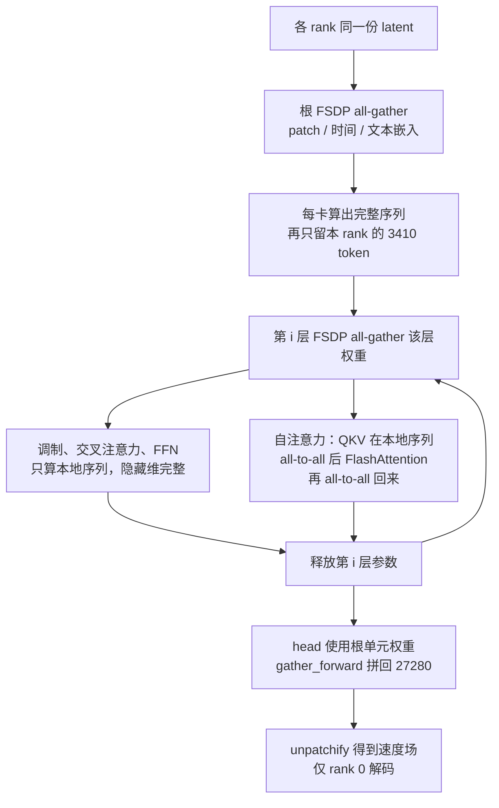

# Wan2.2 TI2V-5B 推理侧并行方式

本文只记录当前仓库里 **TI2V-5B**（任务名 `ti2v-5B`，管道 `wan/textimage2video.py` 的 `WanTI2V`）推理实际用到的并行，以及每一种是怎么挂到一次生成上的。Pipeline、张量形状和采样公式见 [TI2V-5B 推理范围与 Pipeline](ti2v_5b_inference.md)。它们在调用顺序中的位置是该文第 5.3 节。

范围是 `generate.py` 拉起的这一次视频生成。单卡 kernel 内部的线程并行（cuBLAS、FlashAttention 在一张 GPU 上的实现）不在这里展开。

## 1. 总览

TI2V-5B 推理配置出来的并行只有两种，默认都关闭：

| 并行 | 切什么 | 开关 | 作用在谁身上 | 通信 |
| --- | --- | --- | --- | --- |
| FSDP | 参数。`FULL_SHARD`，进模块时 all-gather，算完释放 | `--dit_fsdp`、`--t5_fsdp`，两个独立 | DiT 与 umT5 各包一层，VAE 不包 | NCCL all-gather，默认进程组 |
| Ulysses 序列并行 | 激活的序列维 `s`。自注意力里再用 all-to-all 换成 head 维 | `--ulysses_size > 1`，且必须等于 `WORLD_SIZE` | 只换 DiT 的 `forward` 和每层 `self_attn.forward` | NCCL all-to-all / all-gather，同一个默认进程组 |

一次生成的 batch 是 1。所有 rank 持有同一条 prompt、同一份噪声，协作这一条视频，而不是各算各的样本。50 步去噪、每步里的条件前向和无条件前向，都是串行调用；并行发生在 **一次 DiT 前向的内部**。

默认 720p 文生视频（`1280*704`、121 帧）的形状，后面的例子都用它：

- latent `[48, 31, 44, 80]`
- patch `(1, 2, 2)` 之后序列长度 **27280**，隐藏维 **3072**，**24** head，head 维 128，**30** 层
- 文本序列最长 512，T5 隐藏维 4096，**24** 层、64 head

8 卡且 `--ulysses_size 8` 时，每卡分到 `27280 / 8 = 3410` 个 token；自注意力内部每卡看到全部 27280 个 token、`24 / 8 = 3` 个 head。

单进程是默认路径，不建进程组。README 里约 24GB 显存的命令走的就是这条，显存靠 `--offload_model`、`--convert_model_dtype`、`--t5_cpu`，不靠上面两种并行。

## 2. 进程组：两种并行的公共底座

`generate.py` 读 `RANK`、`WORLD_SIZE`、`LOCAL_RANK`。单进程时三者缺省为 0、1、0。

多进程时：

```text
torch.cuda.set_device(local_rank)
dist.init_process_group(backend="nccl", init_method="env://")
```

此后 FSDP 和 Ulysses 都使用这份默认进程组。代码里没有 `dist.new_group`，因此做不到「FSDP 一组、Ulysses 另一组」。`--ulysses_size > 1` 时还有一条断言：`ulysses_size == world_size`。8 卡官方命令就是两者都铺满全部 8 个 rank。

进程组建好之后还有三处与并行配套的 rank 间约定，它们本身不切张量：

1. rank 0 的 `base_seed` 经 `broadcast_object_list` 发给所有 rank。Ulysses 要求各卡切的是同一条序列，种子必须一致。
2. 若开了 prompt 扩展，只有 rank 0 调用扩展模型，再把扩展后的字符串广播出去。
3. 采样结束后只有 rank 0 做 `vae.decode` 并写 mp4，然后 `barrier`，最后 `destroy_process_group`。

未指定 `--offload_model` 时，单进程默认为 `True`，多进程默认为 `False`。只要打开 `t5_fsdp`、`dit_fsdp` 或 Ulysses，`WanTI2V` 会把 `init_on_cpu` 关掉，权重按 FSDP 的 `device_id` 放到对应 GPU 上，而不是先整模放在 CPU。

## 3. FSDP：切参数

实现全部在 `wan/distributed/fsdp.py` 的 `shard_model`。DiT 和 T5 调用的是同一个函数。TI2V 不传 `use_lora`，因此 `use_orig_params=False`，参数被收成 `FlatParameter`。

```text
FSDP(
    sharding_strategy = FULL_SHARD,
    process_group     = None,          # 默认进程组
    auto_wrap_policy  = 模块 m 属于 model.blocks 时单独包一层,
    mixed_precision   = 参数 bf16，归约 fp32，buffer fp32,
    device_id         = local_rank,
    use_orig_params   = False,
)
```

`FULL_SHARD` 是 ZeRO-3 的切法：每个 rank 常驻一份参数碎片；进入该 FSDP 单元的前向时 all-gather 出完整权重，前向结束再释放。TI2V 在 `eval()`、`requires_grad_(False)` 和 `torch.no_grad()` 下运行，没有反传，梯度 all-reduce 和优化器状态都不会发生。`reduce_dtype=fp32` 只是混合精度配置留在那里。采样循环外面包了 `model.no_sync()`（模型不是 FSDP 时退化成空上下文），用来跳过梯度同步，数值上不起作用。

包裹粒度由 `lambda m: m in model.blocks` 决定。`blocks` 里的每一层是一个 FSDP 单元，其余参数留在根单元。根单元在整个 `forward` 期间保持 gather，每一层只在自己的 `forward` 期间 gather。峰值权重大约是「根参数 + 当前这一层的完整权重」。

`free_model()` 写在同一文件里，用来清掉 flat param 的 storage。TI2V 的 `t2v()` / `i2v()` 不调用它。

### 3.1 DiT：`--dit_fsdp`

挂载点是 `WanTI2V._configure_model`。顺序固定为：先 `eval()`，若开了 Ulysses 就先替换 `forward`，`barrier`，然后才 `shard_fn(model)`。FSDP 的前向钩子包在已经替换过的 `forward` 外面。

`shard_fn` 是 `partial(shard_model, device_id=device_id)`，精度用函数默认值，与 `shared_config.py` 的 `param_dtype = bfloat16` 一致。DiT 使用默认的 `sync_module_states=True`：各 rank 都 `from_pretrained` 之后，FSDP 先把 rank 0 的参数广播齐，再切分。

TI2V 的 DiT 有 30 个 `WanAttentionBlock`，所以有 30 个块级 FSDP 单元。根单元里是：

- `patch_embedding`（`Conv3d`）
- `text_embedding`、`time_embedding`、`time_projection`
- `head`

`freqs` 是普通张量属性，没有 `register_buffer`，FSDP 不切它，每张卡留一份完整 RoPE 频率表。

不开 FSDP 时，`--convert_model_dtype` 才会把整份 DiT `.to(param_dtype)`。打开 FSDP 后这条转换被跳过，bf16 由 all-gather 时的 `MixedPrecision` 完成。

### 3.2 T5：`--t5_fsdp`

`T5EncoderModel` 在 CPU 上加载 `models_t5_umt5-xxl-enc-bf16.pth` 之后，若传入 `shard_fn`，立刻调用 `shard_fn(model, sync_module_states=False)`。各 rank 已经读了同一份 checkpoint，不再从 rank 0 广播。

被切的是 `T5Encoder` 的 24 层 `T5SelfAttention`。token embedding 和最后的 LayerNorm 留在根单元。T5 没有序列并行：每个请求只编码两次（正向 prompt 与负向 prompt），序列最长 512，注意力是 `einsum`，不走 FlashAttention，也不走 Ulysses。

`--t5_cpu` 的注释写明它只在不开 `--t5_fsdp` 时使用。入口没有对这两个开关再做互斥断言。开了 `--t5_fsdp` 就不要再把 T5 整模留在 CPU 上。

### 3.3 谁不被 FSDP 切

`Wan2_2_VAE` 在每个 rank 的 `cuda:{local_rank}` 上各放一整份。`i2v()` 里每个 rank 都会 `vae.encode` 同一张图。`t2v()` / `i2v()` 的 `vae.decode` 只在 rank 0 执行。VAE 的时间维由因果卷积 cache 串行扫描，不参与 FSDP 或 Ulysses。

## 4. Ulysses：切序列

开关是 `--ulysses_size`。`generate.py` 把它变成 `use_sp=(ulysses_size > 1)` 交给 `WanTI2V`。`use_sp` 为真时 `sp_size = world_size`，否则 `sp_size = 1`。

TI2V 有 24 个 head，因此 `num_heads % ulysses_size == 0`。大于 1 的合法取值是 24 的因子：2、3、4、6、8、12、24，并且这个数必须等于进程数。注释和参数说明里出现的 USP，在本路径上指的就是这一套 Ulysses，不是外层 Ring、内层 Ulysses 的二维上下文并行。

### 4.1 替换哪两个函数

`_configure_model` 在包 FSDP 之前做两处猴子补丁，对象都是 DiT：

| 原函数 | 替换为 | 文件 |
| --- | --- | --- |
| `WanModel.forward` | `sp_dit_forward` | `wan/distributed/sequence_parallel.py` |
| 每层 `WanSelfAttention.forward` | `sp_attn_forward` | 同一文件 |

`WanCrossAttention.forward` 不替换。交叉注意力、FFN、调制都还是 `wan/modules/model.py` 里的实现，只是输入已经是序列分片。

### 4.2 序列先补齐，再按 rank 切开

`t2v()` 与 `i2v()` 都把 token 数向上取整到 `sp_size` 的倍数，多出来的位置在 `forward` 里补 0。默认 27280 能被 8 整除，8 卡时没有额外 padding。

`sp_dit_forward` 的前半段和单卡 `WanModel.forward` 相同：每张卡用完整权重做 patch 嵌入、时间嵌入和文本嵌入，得到完整的 `[1, seq_len, 3072]`。然后按序列维 `dim=1` 切开，只留本 rank 那一段：

```text
x  = chunk(x,  world_size, dim=1)[rank]    # 视频 token
e  = chunk(e,  world_size, dim=1)[rank]    # 给 head 的时间调制
e0 = chunk(e0, world_size, dim=1)[rank]    # 给 30 层的 6 组调制
```

文本 `context` 不切，每张卡保留补齐到 512 的完整文本嵌入。嵌入这一段在每张卡上各算了一遍完整序列，真正按序列拆开的计算从 30 层 block 开始。

30 层之后，`head` 吃的是本地这一段和已经切开的 `e`。接着 `gather_forward` 对序列维做 all-gather，拼回完整序列，再 `unpatchify`。每张卡都得到完整的速度场；只有 rank 0 把它送进 VAE。

### 4.3 自注意力里的 all-to-all

`sp_attn_forward` 仍在本地序列上做 Q/K/V 投影和 RoPE。RoPE 使用 `sequence_parallel.py` 里的 `rope_apply`：按完整网格算出频率，再取本 rank 对应的那一段，所以位置和切分前一致。`freqs` 本身不切。

然后调用 `wan/distributed/ulysses.py` 的 `distributed_attention`：

```text
进入注意力前，q/k/v 的形状是 [1, 3410, 24, 128]     # 8 卡默认形状
all-to-all：scatter head 维，gather 序列维
注意力里的形状是     [1, 27280, 3, 128]
FlashAttention 在这张卡的 3 个 head 上看到完整序列
all-to-all：scatter 序列维，gather head 维
回到 [1, 3410, 24, 128]，再做输出投影
```

q、k、v 各一次 all-to-all，输出再一次，每层自注意力 4 次 all-to-all。`all_to_all` 的 `group` 使用默认值，也就是第 2 节的那个进程组。FlashAttention 仍要求 CUDA，这一要求和单卡相同。

传给 FlashAttention 的 `k_lens` 是切开之前的真实 token 数（默认 27280），不是每卡的 3410。all-to-all 把各 rank 的序列按 rank 顺序拼回去，padding 仍在整段序列的末尾，用这个长度把 padding 掩掉。

交叉注意力不走这 4 次通信。query 来自本地 3410 个视频 token，key/value 来自本卡上完整的文本 token（长度不超过 512）。FFN 同样只吃本地序列，权重在隐藏维上是完整的 3072 与 14336：隐藏维交给 FSDP 在进层时 gather，不按 head 或通道切开。

## 5. 两个开关同时打开时，一次前向怎么走

README 的多卡命令同时打开 `--dit_fsdp --t5_fsdp --ulysses_size 8`。一次条件前向（无条件前向再重复一遍）的顺序是：



两种通信叠在同一次前向上，搬运的对象不同：

- **FSDP all-gather** 搬运这一层的权重。体积跟参数量走，跟序列长度无关。30 层各发生一次，根单元在整个 `forward` 期间保持完整。
- **Ulysses all-to-all** 搬运激活。体积跟序列长度和隐藏维走。只出现在自注意力，每层 4 次。层末的 `gather_forward` 再把序列拼回去，那是 all-gather，不是 all-to-all。

采样循环不改变这个结构。默认 UniPC 50 步，每步顺序调用条件前向和无条件前向，共约 100 次 DiT 前向。下一步的 latent 依赖上一步，步与步之间没有并行。CFG 的两次前向也不拆到不同的卡上。

## 6. 合法组合

单进程下 `--dit_fsdp`、`--t5_fsdp`、`ulysses_size > 1` 都会被断言拒绝。多进程时三个开关可以单独打开，断言只约束 Ulysses 的规模和 head 整除。

| 启动方式 | 每张卡上的 DiT 权重 | 每张卡上的序列 | 计算是否按序列拆开 |
| --- | --- | --- | --- |
| `python generate.py`，不开任何并行开关 | 整份，可再 offload 到 CPU | 整段 27280 | 否。单进程 |
| `torchrun`，只开 `--dit_fsdp` / `--t5_fsdp` | 约 `1 / WORLD_SIZE` 常驻，进层时 gather 完整权重 | 每张卡仍算整段序列 | 否。省的是权重显存，前向计算在各卡重复 |
| `torchrun`，只开 `--ulysses_size`，等于进程数 | 每张卡一份完整复制 | 每卡 `seq_len / WORLD_SIZE` | 是。30 层和自注意力按序列拆开 |
| `torchrun ... --dit_fsdp --t5_fsdp --ulysses_size 8` | 碎片常驻，进层 gather | 每卡 3410 token，注意力时 3 个 head 的全序列 | 是。这是 README 和 `tests/test.sh` 里 TI2V 多卡命令的组合 |

只开 FSDP、不开 Ulysses 时，各卡必须一起进入 all-gather，但每张卡算的是完整序列。输出只采用 rank 0。只开 Ulysses、不开 FSDP 时，序列拆开了，5B 权重在每张卡上仍是完整的一份。

## 7. 和论文推理侧描述的差别

论文推理侧写的是两件事。上下文并行用来降低生成单条视频的延迟，并明确说与训练阶段相同，是二维的：外层 RingAttention，内层 Ulysses。模型切分则是给 Wan 14B 这类大模型缓解显存；因为推理序列很长，FSDP 的通信量小于张量并行，并且能和计算重叠，所以切分方式与训练一致，采用 FSDP。二者合在一起，论文给出的是 Wan 14B 上接近线性的加速。

训练描述里的「FSDP 组大于上下文并行组、`DP = FSDP / CP`、再用外层数据并行扩大 batch」不在这段推理文字里。推理要对齐的是：一条视频上的二维上下文并行，加上大模型上的 FSDP 切参数。

| 论文推理侧 | 本仓库的 TI2V-5B |
| --- | --- |
| 上下文并行是二维的。外层 RingAttention，内层 Ulysses，用来缩短单条视频的延迟 | 只有内层 Ulysses。`--ulysses_size` 必须等于进程数。没有 Ring，没有第二套上下文并行组，也没有外层通信和内层计算的重叠 |
| 大模型（点名 14B）用 FSDP 切参数，不用张量并行 | 可选 `--dit_fsdp` / `--t5_fsdp`，`FULL_SHARD`，按 block 切。隐藏维 3072 不切，这一点与「不用张量并行」一致。5B 的单卡路径约 24GB 就能跑，官方多卡命令仍把 FSDP 和 Ulysses 一起打开 |
| 目标是一条视频的延迟；14B 上接近线性加速 | batch 长度是 1，各 rank 协作同一条视频。加速只来自一维 Ulysses，不是论文的二维上下文并行 |

因此相对论文的推理策略，仓库保留了「在单条视频上切序列，参数用 FSDP 而不是张量并行」。没有保留二维上下文并行。5B 也不是论文里为了显存而点名要做模型切分的那个 14B。

时间步和 VAE 时间维在本仓库里同样不拆：50 步沿 σ 串行积分，`CausalConv3d` 的 cache 按时间顺序扫描，decode 只在 rank 0。这两项论文这段没有讨论。
