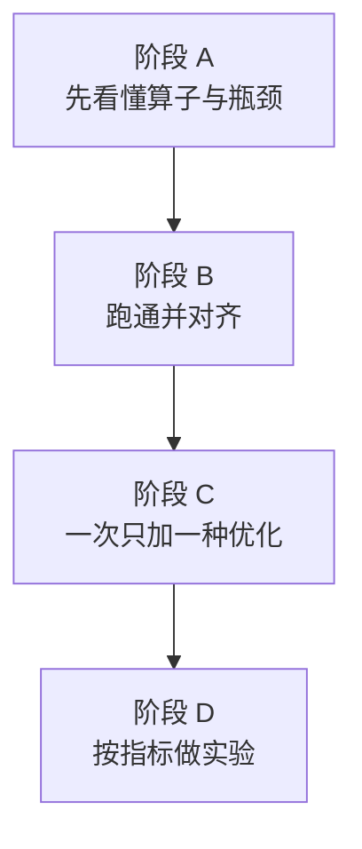

# 面向 SME ARM 的 Wan2.2 TI2V-5B 推理教程与完成路线

本文同时做两件事：说明毕业设计按什么顺序做完，以及做每一步之前要弄懂的概念。代码边界、张量形状和调用顺序以 [ti2v_5b_inference.md](ti2v_5b_inference.md) 为准。那边是「仓库里现在有什么」，这边是「你要学会什么、再改哪里」。

读法：每一阶段先读该阶段开头的知识点，再做后面的任务。知识点都扣在 TI2V 的默认形状上，不单独做一份抽象教材。默认形状是 `1280*704`、121 帧、50 步：latent `[48, 31, 44, 80]`，DiT 序列长度 **27280**，隐藏维 3072，24 个 head，head 维 128。

课题的三段工作对应阶段 A、阶段 C、阶段 D。阶段 B 是正确性门槛。没有和 GPU 参考对齐过的输出，后面的加速比没有意义。

| 课题原文中的工作 | 阶段 | 完成时手里有什么 |
| --- | --- | --- |
| 分析主要算子的计算、访存和并行特征，识别兼容性与瓶颈 | A | 一张按 `t2v()` 填写的算子表，外加一次计时，证明时间花在哪里 |
| 面向 ARM 众核的算子适配、线程并行、向量化、数据布局和访存优化 | B + C | 能在目标 CPU 上跑通的实现，以及一组可单独开关的优化版本 |
| 在深圳超算上部署，从正确性、延迟、吞吐、内存和利用率评估 | D | 固定输入下的对照实验和结论 |

## 1. 先冻结的基座

迁移对象只定 TI2V-5B 的文生视频。任务名 `ti2v-5B`，管道是 `wan/textimage2video.py` 的 `WanTI2V.t2v()`，入口是 `generate.py`。

三个模块里只有 DiT 是热路径：

1. umT5-XXL 编码器：每个请求 2 次，序列长度不超过 512。
2. 一份 Wan DiT：30 层。默认 50 步、每步两次前向（条件与无条件），共约 100 次前向。
3. Wan2.2 VAE 解码：每个请求 1 次，沿 latent 的时间维串行。

调试形状用 `--frame_num 5 --sample_steps 4`。帧数满足 `4n+1`，latent 时间维为 `(5-1)/4+1 = 2`，token 数为 `2 × 22 × 40 = 1760`。功能调通后再回到 121 帧、50 步。

不放进必做范围的部分：FSDP、Ulysses、NCCL；prompt 扩展和 offload；图生视频 `i2v()`；A14B 双专家、`vae2_1`、S2V、Animate；推理服务和批处理。`i2v()` 的算子与 `t2v()` 相同，主实验跑通后再开。算子接口从第一天保留 `dim`、`num_heads`、`head_dim`、`seq_len`、`in_dim`，不要把 3072 或 27280 写进内核。A14B 的 head 维同样是 128，以后换的是宽度、层数和序列长度。

当前实现的 batch 恒为 1。吞吐就是端到端延迟的倒数，除非以后单独做批处理实验。

### 知识点：这条 pipeline 在算什么

TI2V 不直接在像素上迭代。像素视频经过 VAE 会变成小得多的 latent，DiT 在 latent 上完成生成，最后再解码回像素。默认压缩由 `vae_stride = (4, 16, 16)` 决定：时间缩 4 倍，高和宽各缩 16 倍，通道变为 48。121 帧的 `704×1280` 视频因此变成 `[48, 31, 44, 80]`。

文生视频没有真实图像可编码。`t2v()` 直接在这个形状上采样高斯噪声，当作起点。后面 50 步都在改这份 latent。

DiT 一次前向要先把 latent 切成 patch。`patch_size = (1, 2, 2)` 表示时间不切、空间 2×2，所以网格是 `(31, 22, 40)`，排成 27280 个 token，每个 token 3072 维。这和语言模型把句子切成 token 是同一类做法，只是 token 来自视频网格。交叉注意力的「另一句话」是 umT5 输出的文本向量，长度不超过 512，再被线性层投到 3072 维。

每一层 `WanAttentionBlock` 的顺序固定：

1. 用时间步产生 6 组调制向量，对归一化后的激活做缩放、平移，残差上再乘一个门控。这段在代码里强制使用 fp32。
2. 自注意力：token 之间互相看。Q、K 还要做 3D RoPE，把时间、高、宽三个方向编进相位。
3. 交叉注意力：视频 token 作 query，文本 token 作 key/value。视频读文本，文本不读视频。
4. FFN：`3072 → 14336 → 3072`，中间是 tanh 近似的 GELU。

50 步不能并行。`scheduler.step` 用当前 latent 和这一步的模型输出算出下一步 latent，下一步的输入就是这个结果。调度器默认是 Flow-Matching 的 UniPC，实现在 `wan/utils/fm_solvers_unipc.py`。对齐数值时不要换成 `dpm++`。

Classifier-free guidance 是两次前向的线性组合，代码就是：

```text
noise_pred = uncond + guide_scale * (cond - uncond)
```

`guide_scale` 默认 5。条件前向用用户 prompt 的文本向量，无条件前向用负向 prompt。两次前向的权重相同，只有文本条件不同。因此 DiT 的计算量几乎正好是「单次前向 × 100」，不是 50。

VAE 解码发生在 50 步之后，而且只在 rank 0。它把 latent 逐帧送进 3D 因果卷积。后一帧的卷积要看到前一帧留下的 cache，所以帧与帧之间不能换序，也不能并行。

把这四件事记住，后面才不会优化错地方：步与步是串行的，层与层是串行的，CFG 的两次前向彼此独立，VAE 的时间维是串行的。能并行的是同一次矩阵乘内部的行、以及各个 head。

## 2. 总路线



阶段 C 的每个版本相对上一版只多一类改动。加速比的含义取决于分母：ARM 上的加速比一律相对 V0，不相对 GPU 原版。GPU 原版只用来说明「现有 CUDA 实现有多快」，以及提供数值对照。

| 版本 | 相对上一版只多什么 | 学会用它回答的问题 |
| --- | --- | --- |
| V0 | 去掉 CUDA 绑定后的 PyTorch eager 路径 | 正确的 ARM 基线。慢是允许的 |
| V1 | 分块注意力，不分配完整分数矩阵 | 长序列注意力的内存问题是否被解开 |
| V2 | DiT 的大 Linear 改为 SME 外积累加 | 矩阵指令吃掉了多少计算时间 |
| V3 | 布局、Norm / GELU 融合、减少无谓的 dtype 往返 | 算力之外，访存还剩多少 |
| V4 | 线程数、绑核、NUMA 放置 | 众核扩展到什么程度会变平 |
| V5 | VAE 帧内并行 | 尾部延迟是否值得做 |

V0 到 V2 是论文主线。V3、V4 对应课题里的数据布局、访存和线程并行。V5 只有剖析显示 VAE 占比不小才做深。T5 保持 PyTorch 实现：每请求两次，序列不超过 512。

## 3. 阶段 A：看懂瓶颈

这一阶段的任务是把静态清单变成你自己算出来、并尽量测出来的结论。静态形状见 [ti2v_5b_inference.md](ti2v_5b_inference.md) 第 4 节和第 6 节。

### 知识点：GPU 这份实现假设了什么

现有代码是为 NVIDIA GPU 写的。GPU 上成千上万个线程按 warp 锁步执行，矩阵乘交给 Tensor Core，长序列注意力交给 FlashAttention 的 CUDA kernel，多卡通信用 NCCL。显存是独立的 HBM，和主机内存不是同一块。

深圳超算上的 SME ARM 众核不是「把 CUDA 换成另一种 GPU」。它是一群 CPU 核：每核有自己的一级、二级缓存，一组核共享更大的末级缓存，跨 NUMA 节点访问内存更慢。并行单位是操作系统线程，不是 warp。一条线程里再用向量指令和 SME 矩阵指令把数据做宽。

因此仓库里的三处 GPU 假设不能靠换编译器消失：

- 设备名 `cuda`、`autocast('cuda')`、`torch.cuda.*` 是运行时 API，CPU 上不存在。
- `flash_attention` 调用的是 CUDA kernel，并且函数内部断言张量在 CUDA 上。
- FSDP 和 Ulysses 用 NCCL 在多张 GPU 之间切权重、切序列。目标机器上没有这个通信域。众核并行要重新划分，划分依据是第 1 节里的数据依赖，不是 `--ulysses_size 8`。

`WanSelfAttention` 直接调用 `flash_attention`。同文件里基于 `scaled_dot_product_attention` 的函数没有被 DiT 用到。替换点就是这两处调用。

### 知识点：算术强度，先判断算子吃计算还是吃带宽

一个算子慢，只可能是两类原因占主导：算力不够，或者数据搬不赢。算术强度把二者放在一起：

```text
算术强度 = 运算次数 / 需要从内存搬动的字节数
```

屋顶线（roofline）用平台的两个峰值作对照。峰值算力除以峰值带宽，得到「脊点」，单位也是运算次数/字节。强度远高于脊点的算子，优化方向是把乘加做满，典型是大矩阵乘。强度远低于脊点的算子，优化方向是少搬数据，典型是逐元素的 Norm、RoPE、残差加。块大小、融合和布局都是在改这个比值的分母。

下面用默认形状算一次，学会以后每改一个算子都先算再写代码。矩阵乘 `Y = X W`（`X` 为 `M×K`，`W` 为 `K×N`）的乘加次数按 `2·M·N·K` 计。

**FFN 的第一个 Linear。** `M = 27280`，`K = 3072`，`N = 14336`：

```text
2 × 27280 × 3072 × 14336 ≈ 2.40×10^12 次运算
```

第二个 Linear 的 `K` 与 `N` 对调，运算次数相同。一层 FFN 约 `4.8×10^12` 次。

**自注意力的 Q、K、V、输出四个 Linear。** 每个都是 `27280×3072` 乘 `3072×3072`，四个合计约 `2.1×10^12` 次，小于一层 FFN。

**自注意力本体。** `scores = Q K^T` 与 `out = scores V` 合在一起约 `4 · L^2 · d`，`d = 3072`：

```text
4 × 27280^2 × 3072 ≈ 9.1×10^12 次运算
```

所以在默认长度下，一层里自注意力的运算次数高于 FFN，大约是 FFN 的 1.9 倍。交叉注意力的 key 长度不超过 512，运算次数大约比自注意力小两个数量级，不是热点。

30 层、100 次前向之后，仅自注意力就在 `2.7×10^16` 次运算这一量级，FFN 约 `1.4×10^16`。T5 和调度器可以不参与这道比较。

运算次数大，不等于实现难度相同。FFN 是规则的大 GEMM，算术强度很容易到几千次运算/字节，在多数 CPU 上属于算力瓶颈，适合 SME。自注意力如果先把 `27280×27280` 的分数矩阵写出来，单个 head 的 fp32 矩阵约 3 GB，24 个 head 约 70 GB，内存首先就不成立。FlashAttention 在 GPU 上用分块避开了这块分配。ARM 上必须用同样的思路。分块之后，注意力内部的小矩阵乘也可以交给 SME，它就从「不能运行」变成「又一个大 GEMM 加 softmax」。

Norm 和 RoPE 相反。RMSNorm 对每个 token 的 3072 维做一次归约再写回，运算次数和字节数是同一量级，算术强度接近 1。它不会成为总时间的大头，但每层都做、而且现有代码先转 fp32 再转回来，会白搬几次。这类算子放到 V3，不要在 V2 之前花主要精力。

### 知识点：剖析时切在 pipeline 的自然边界上

计时点就放在已经存在的三段：T5 两次编码、DiT 的一步（条件与无条件分开记）、VAE 一次解码。DiT 内部再拆 FFN 的 Linear、QKV 的 Linear、自注意力、交叉注意力、Norm 与 RoPE。

GPU 上计时必须在区间两端同步设备，否则测到的是启动开销而不是 kernel。CPU 上用墙钟时间，并且先跑一步热身，不把第一次加载权重、第一次进入 SME 流模式算进表内。写 mp4 的时间单独记，`sample_fps` 不参与网络计算。

占比表决定后面的顺序。DiT 占绝对多数时按 V1、V2 做，VAE 留到 V5。若在这台 CPU 上 VAE 占比已经很高，把 V5 提前。不要照着 GPU 论文的经验排优先级。

### A1. 平台事实

写内核之前，在账号上记下这些数。后面的 tile 和线程数都从这里来，不能从教程里抄：

- CPU 型号、物理核心数、NUMA 节点数、每级缓存容量
- 实现的是 SME 还是 SME2，streaming vector length（SVL，单位是位，必是 128 的倍数）
- 编译器是否提供 SME 的 ACLE 头文件；节点上有没有 BLAS、ARM Compute Library、KleidiAI 或厂商数学库
- 作业内存上限和调度系统的资源写法

SVL 决定 ZA 累加器能装下的 tile 边长。没有量到 SVL，就不能把 tile 写成常数。

### A2. 调用链上的算子清单

按 `t2v()` 的执行顺序填，不按目录填。每行至少有：代码位置、形状、dtype、每个视频的调用次数、是否依赖 CUDA、运算次数量级、工作集能不能放进内存。

| 顺序 | 代码 | 次数（121 帧、50 步） | 迁移时先记住的性质 |
| --- | --- | --- | --- |
| 文本编码 | `wan/modules/t5.py` 的 `T5Attention` | 2 × 24 层 | 序列短，`einsum` 会物化分数矩阵，但矩阵很小，可作「朴素注意力」的数值参照 |
| 去噪循环 | `t2v()` | 50 × 2 | 控制流；依赖在步与步之间 |
| Patch 嵌入 | `Conv3d`，核 `(1,2,2)` | 100 | 运算量小 |
| 时间与文本嵌入 | `time_embedding`、`text_embedding` | 100 | 小矩阵；时间嵌入在 fp32 |
| 一层主体 | `WanAttentionBlock` | 100 × 30 | 性能主体 |
| 自注意力 | `flash_attention` | 每层 1 次 | CUDA 绑定；禁止物化 `L×L` 分数矩阵 |
| 交叉注意力 | `WanCrossAttention` | 每层 1 次 | query 长，key/value 短 |
| FFN | 两个 Linear 加 GELU | 每层 1 次 | 最大的单块规则 GEMM |
| QKV 与输出投影 | 自注意力 4 个方阵 Linear，交叉注意力另有一组 | 每层 | 与 FFN 一起做 SME |
| Norm / RoPE | `WanRMSNorm`、`WanLayerNorm`、`rope_apply` | 与层数同量级 | 低算术强度；现实现有 fp32 往返 |
| 求解器 | `FlowUniPCMultistepScheduler.step` | 50 | 必须数值对齐，运算量可忽略 |
| 解码 | `CausalConv3d`，逐帧 `decode` | 31 帧串行 | 正确性必需；时间维有 cache 依赖 |

完成判据：表是你自己算过运算次数的，不是从本文抄形状。

### A3. 一次端到端剖析

在 GPU 参考机或 ARM 的 V0 上做出 A 节知识点里的分段计时。完成判据是一张时间占比表，并写明 V5 做深还是只保留正确实现。

### A4. 兼容性清单

把「不能直接跑」写成会在阶段 B 逐条消掉的列表：

| 绑定 | 位置 |
| --- | --- |
| 设备写成 `cuda:{id}` | `WanTI2V.__init__` |
| `torch.amp.autocast('cuda', ...)` | `t2v()`，以及 `WanAttentionBlock` 里的 fp32 段 |
| `flash_attention` 断言设备是 CUDA 并调用 FlashAttention | `wan/modules/attention.py` |
| `torch.cuda.empty_cache` / `synchronize` | offload 路径；基座关闭 offload 后可以不走 |
| NCCL | `generate.py`；单进程不进入 |

## 4. 阶段 B：跑通并对齐

目标是 V0。同一条 `t2v()` 在目标 CPU 上出视频，并与 GPU 参考落在事先写明的误差内。此阶段不追求快。调试形状上允许注意力先用朴素实现，因为 1760 的分数矩阵放得下；27280 不允许用朴素实现交差。

### 知识点：分块注意力与在线 softmax

标准注意力对一行 query 做三件事：和所有 key 做点积，softmax，再对 value 加权求和。softmax 的分母是这一行全部分数的指数和，看上去必须先看到整行。在线 softmax 用两个滚动标量去掉这个要求：当前见到的最大值 `m`，以及按这个最大值平移之后的指数和 `l`。来了新的一块 key 时，若新的最大值更大，就把旧的累加和、旧的 `l` 乘上 `exp(m_old - m_new)`，再把新块加进去。输出的分子用同样的系数缩放。一块处理完就可以丢掉这块分数。

对 TI2V 的一个 head，query 行很长，key 也长。外层沿 query 分块，内层沿 key 分块。每个 query 块只保留一块 `[Bq, head_dim]` 的输出累加器，不保留 `[Bq, 27280]` 的分数。`head_dim` 是 128，块的矩阵乘是小 GEMM。缩放系数与 FlashAttention 的缺省一致，为 `1/sqrt(head_dim)`。代码里调用 `flash_attention` 时没有另传 scale，对齐时不要多除或少除一次。

交叉注意力把 key 块的长度上限换成文本长度（不超过 512），滚动公式不变。接口用长度参数区分，不要写成两个无关的函数。

T5 的 `einsum` 注意力是「先物化分数再 softmax」的参照实现，序列短，数值好检查。把它当作在线公式的测试oracle：用同一组短 Q/K/V，两种写法的输出应当接近。不要把 T5 的实现直接套到 27280 上。

### 知识点：误差从哪来，怎样才算对齐

CPU 结果不会和 GPU 逐比特相同。bf16 尾数只有 7 位，fp32 有 23 位。矩阵乘的累加顺序不同，误差就会不同。50 步还会把每步的误差送进下一步。因此要分清三类差异，不要混成一个「误差很大」：

1. 算法是否一致：朴素注意力和在线 softmax 在 fp32 下应当非常接近。若这里已经差很远，是公式写错，不是 dtype。
2. dtype：同一算法的 fp32 与 bf16。先记录这个差距，作为后续阈值的地板。
3. 优化是否改变了数学：融合、重排累加顺序会动第 2 类误差。超过已记录的地板，就回到第 1 类去查。

比较用最大绝对误差、平均绝对误差，以及像素的 PSNR。阈值在第一次对照时测定，写进实验说明，之后不随版本放宽。放宽阈值等于把错误的优化判成正确。

调度器、种子和负向 prompt 都是数值的一部分。`--base_seed` 固定后，`t2v()` 里的 `torch.Generator` 决定初始噪声。换调度器或换负向 prompt，对照张量全部失效。

### B1. 运行路径

单进程，关闭 FSDP、Ulysses、prompt 扩展和 offload。权重目录见 [ti2v_5b_inference.md](ti2v_5b_inference.md) 第 3 节。设备从写死的 `cuda` 改为可配置。autocast 的设备类型随设备走。若这颗核没有可用的 bf16 矩阵通路，正确性路径先用 fp32，并在误差表里单独占一行。

### B2. 可移植注意力

调用约定保持现有布局：Q/K/V 为 `[B, L, heads, head_dim]`，`B = 1`，`head_dim = 128`，`window_size = (-1, -1)`。自注意力 `L = 27280`，交叉注意力的 key/value 不超过 512。

先在 1760 token 上和 GPU 导出的注意力输出对比，再在 27280 上只跑分块实现，并记录峰值内存。完成判据：短序列对齐；长序列的峰值内存相对朴素注意力下降一个数量级以上。

### B3. 全流程对照

在 GPU 上用固定种子导出：

1. 正负两条 T5 context
2. 初始噪声 latent
3. 第 1 步两次 DiT 输出、CFG 之后的预测、`scheduler.step` 之后的 latent
4. 最终 latent，以及 VAE 解码后的像素

完成判据：调试形状全流程通过；121 帧、50 步至少一次，像素误差落在已记录阈值内。

## 5. 阶段 C：一次加一种优化

每一节先是这种方法在改算术强度或并行度的哪一部分，然后才是任务。V0 的数值路径要能切换回来，否则无法消融。

### 知识点：SME 外积在算哪一种矩阵乘

SME 是 Armv9 上的可伸缩矩阵扩展。它在向量寄存器之外增加一块二维累加存储 ZA。进入 streaming 模式后，向量长度变为 SVL，可以和普通 SVE 的向量长度不同。ZA 的边长由 SVL 决定，所以 tile 是平台参数，不是源码里的魔数。

一条典型的外积指令做的事可以收成：

```text
ZA 的一块 tile  +=  向量 a  的外积  向量 b
```

它不一次乘完 `27280×3072×14336`。内核把大矩阵切成很多 tile，沿 `K` 方向循环：每次取 A 的一小列面板和 B 的一小行面板，外积累加进 ZA，`K` 耗尽后把 ZA 写回输出。这和 Tensor Core 把大 GEMM 拆成小块累加是同一结构，累加器换成了 ZA，线程换成了 CPU 核。

要让外积的加载是连续的，A、B 不能一直保持 PyTorch 默认的行优先。打包把一个 tile 需要的 `K` 方向元素排到连续地址。权重在 `from_pretrained` 之后打包一次，100 次前向都复用。激活每个前向都变，只能每次打包。打包时间要单独计，否则看不出 ZA 上的乘加是否变快，只看见内存搬动。

进入和退出 streaming 模式有成本。一层里的大 Linear 可以包在同一次 streaming 区间里。时间嵌入那种小矩阵不要为它进出一次 streaming，继续走 PyTorch。

论文里的「算子适配」需要你能讲清打包、tile 和累加这三步。实施顺序可以是：先用节点上的 KleidiAI、ARM Compute Library 或厂商 BLAS 跑通 V2 的性能和接口，再自己写一个 tile 的外积循环，接到同一套打包之后。库负责让实验跑起来，自己写的 tile 负责把 SME 的数据流讲清楚。只调用库、说不清 ZA 里累加的是输出的哪一块，实验章节会缺方法。

bf16 外积是否可用取决于 SME 还是 SME2，以及具体指令。A1 没记这一项之前，不要假设 GPU 上的 bf16 权重能直接送进 ZA。

### C1. SME GEMM（V2）

覆盖自注意力和交叉注意力里达到大矩阵规模的 Linear，以及 FFN 的两层。文本嵌入和时间嵌入保留 PyTorch。

完成判据：与 V0 同一 Linear 的输出落在阈值内；在默认长度上，FFN 与 QKV 的合计时间低于 V0，且打包时间被单独列出来。

### 知识点：块大小是在缓存和 ZA 之间做选择

V1 已经能算对。性能版要选 `Bq` 和 `Bk`。query 块和 key 块同时驻留时，工作集大致是这几块激活加上 `Bq×Bk` 的分数（分数只在寄存器或很小的缓冲里，不进主存的大矩阵）。块太小，外积和加载的比例变差，算术强度下降。块太大，挤出缓存，开始反复读主存里的 K、V。

head 之间没有数据依赖，适合作为线程的外层。同一个 head 内部的 key 循环有在线 softmax 的依赖，不能把同一行 query 的 key 块随便分给多个线程再无同步地写同一个累加器。

交叉注意力不要分配自注意力那套按 27280 准备的工作区。key 很短时，内层循环可能只有一块。

### C2. 把 V1 做快

矩阵乘能调用 C1 的 SME GEMM 就复用，softmax 和缩放用向量指令。完成判据：27280 上单层自注意力快于 V0 的 PyTorch 注意力，峰值内存仍满足 B2。

### 知识点：布局和融合改的是字节数，不是公式

现有 block 里有几处白搬：

- RMSNorm、LayerNorm 和残差调制先 `.float()` 再 cast 回去。每一层、每一个 token 的 3072 维因此多走几次内存。若选定一种 dtype 能稳住 B3 的误差，就固定下来。
- GELU 紧跟 FFN 第一个 Linear 的输出。输出 `27280×14336` 约 780 MB（按 bf16 计）。融进 GEMM 写回就少写一次再读一次。融合不改变定义时，误差应仍在 dtype 地板附近；变大就说明融合改了舍入的位置，要单独记录。
- RoPE 按网格 `(31, 22, 40)` 做逐元素复数乘，运算轻，索引碎。为它把激活从 GEMM 布局转置成另一种布局，往往比 RoPE 本身更贵。让 RoPE 适应 GEMM 的布局。
- DiT 激活是 `[token, channel]`，VAE 是带时间维的 NCHW 式卷积。两套布局只在 pipeline 边界转换一次，不要在每一层之间转换。

这些优化的加速比通常小于把 GEMM 从通用 BLAS 换成 SME。它们回答的是课题里的「访存」，用增量时间或带宽计数说明，不和 V2 的加速比加在同一个百分比里。

### C3. 数据布局与融合（V3）

完成判据：相对 V2，DiT 单步时间下降，或同样步数下可观察的搬动量下降；B3 的误差表补一行。

### 知识点：众核能加速的只有没有依赖的那一维

加速比是 `T(1) / T(P)`，并行效率是加速比再除以线程数 `P`。效率随 `P` 下降，通常是三种原因：剩下的串行部分（Amdahl）、线程在等同一块内存（带宽）、线程跨 NUMA 去读别人节点上的数据。

TI2V 里哪些维不能并行，第 1 节已经由数据依赖决定了。这里复述成实现时的约束：

| 并行维 | 能否并行 | 原因 |
| --- | --- | --- |
| 去噪步 | 不能 | 下一步 latent 依赖上一步 |
| CFG 两次前向 | 可以，但要付内存 | 权重可共享，激活要两份。先看峰值内存再决定 |
| 30 层 | 不能 | 下一层的输入是上一层的输出 |
| head | 能 | 注意力输出在 head 维上独立 |
| GEMM 的行块 | 能 | 不同输出行写入不同位置 |
| VAE 的 latent 帧 | 不能 | 因果卷积的 cache 按时间传递 |
| VAE 帧内空间与通道 | 能 | 只在 V5 使用 |

NUMA 上，一块内存在第一次被写入的节点上分配（first touch）。若主线程把激活全部分配好，再把计算分给其他节点的核，那些核会一直远程读。分配和计算要用同一组线程，并绑核。曲线变平的那一点要写明是带宽、同步还是 tile 已经小于单核一次能做的活，这就是「众核能力用到什么程度」的证据。

不要把 GPU 的 Ulysses 搬过来。Ulysses 是在多张 GPU 之间用 all-to-all 交换 head 和序列，通信栈是 NCCL。这里的 head 并行只是同一进程里的线程划分。

### C4. 线程曲线（V4）

线程数从 1 扫到物理核心数。记录绑核和数据所在 NUMA 节点。完成判据：一张加速比曲线，以及变平原因的说明。

### 知识点：因果卷积的依赖比 DiT 的层依赖更窄

`CausalConv3d` 把时间维的填充放在过去一侧。有 cache 时，把上一帧留下的边界拼到当前帧前面，再做普通卷积。`decode` 因此写成 31 次循环。并行只能发生在一次卷积的空间位置和输出通道上。打乱帧序或丢掉 cache，画面会在时间上错位，像素误差不会只是数值噪声。

若占比低，论文里报告占比并保留正确实现，就是完成。不必为了「每个模块都有 SME」去做一套卷积库。

### C5. VAE（V5）

完成判据二选一：帧内并行后的解码时间，或 A3 的占比加上「不做深」的决定。

## 6. 阶段 D：用实验回答课题

### 知识点：五项指标各问一个不同的问题

| 指标 | 它回答的问题 | 测错时的常见后果 |
| --- | --- | --- |
| 正确性 | 优化有没有把生成算成另一个函数 | 只测最终版，中间某个融合已经偏了却被最后的阈值盖住 |
| 执行延迟 | 一条视频要等多久 | 把加载权重、第一次 streaming、写 mp4 算进算法时间 |
| 吞吐率 | 单位时间能做几条 | 在 batch = 1 时另造一个和延迟无关的吞吐；或用 GPU 的条/秒减去 ARM 的条/秒 |
| 内存开销 | 这台机器放不放得下，分块有没有生效 | 只报权重体积，不报注意力工作区和峰值 RSS |
| 资源利用率 | 加了核之后活有没有铺开 | 没有计数器却写一个利用率百分比 |

延迟至少拆成 T5、DiT 单步、100 次前向合计、VAE、写视频。吞吐取端到端延迟的倒数，单位用条/小时，并另报 DiT 步/秒。内存报进程峰值 RSS，以及 DiT 权重、激活、注意力块缓冲、VAE cache。权重只计一份 5B DiT。有硬件计数器就记算力和带宽利用率；没有就用加速比和峰值内存说明。

每个优化版本都复测正确性。消融一次只开一类优化，否则无法把时间变化归到 SME、分块、布局或线程上。

### D1. 作业里固定的东西

同一份代码用选项切换 V0 到最终版。作业脚本固定检查点、`--task ti2v-5B`、`--size 1280*704`、帧数、步数、`--base_seed`、线程数、绑核和优化开关。调试作业用 5 帧 4 步，正式表用 121 帧 50 步。两种都要能复现。

### D2. 最少要有的实验

1. V0 在调试形状和默认形状上各一条。
2. V1、V2 相对 V0 的延迟、峰值内存和正确性。
3. 在 V2 上单独打开 V3 或 V4。
4. 线程数至少包含 1、若干中间值和满核。
5. 若做了 V5，VAE 时间单独一行。

## 7. 建议的完成顺序

做的顺序按依赖，不按论文章节。论文仍可写成分析、方法、实验。

| 序号 | 任务 | 先弄懂 | 完成判据 |
| --- | --- | --- | --- |
| 1 | A1 平台参数 | SME 的 SVL 与 ZA 边长的关系 | 核心数、NUMA、SVL、bf16 外积是否可用、工具链 |
| 2 | A2、A4 | 算术强度和本文中的运算次数算法 | 自己算过的算子表、CUDA 绑定表 |
| 3 | B1 能进入 `t2v()` | pipeline 四段：T5、噪声、循环、解码 | 调试形状跑完 4 步 |
| 4 | B2 分块注意力 | 在线 softmax | 1760 对齐；27280 内存可控 |
| 5 | B3 全流程对齐 | 三类误差 | 调试形状通过；完整形状至少一次 |
| 6 | A3 剖析 | 计时边界与同步 | 时间占比，决定 V5 深浅 |
| 7 | C2 / V1 性能 | 块大小与缓存 | 长序列注意力快于 V0 |
| 8 | C1 / V2 SME GEMM | 外积、打包、streaming 成本 | FFN 与 QKV 对齐且更快，打包单独计时 |
| 9 | C4 / V4 线程 | 加速比、first touch | 曲线和变平原因 |
| 10 | C3 / V3 布局与融合 | 融合去掉的是哪一次读写 | 相对 V2 的增量，并复测误差 |
| 11 | C5 / V5 | 因果 cache | 时间数据或「不做深」的记录 |
| 12 | D | 五项指标的定义 | 正式形状的完整表 |

1 到 6 结束时，分析和「能跑通」都已经成立。7 到 10 是性能研究。12 只采集，不再改公式。

## 8. 做到哪一步可以停

1. 必须留下：自己算过的算子与瓶颈、B 的正确性、V0/V1/V2 的对照、单线程和满核的延迟与内存。这覆盖课题的三段要求。
2. 有余量再做：V3、更细的绑核、VAE 卷积、`i2v()`。
3. 不做：服务化、多卡 Ulysses、S2V、Animate。A14B 只在内核已按形状参数化、并且 TI2V 的正式表已经跑完之后，用作复用验证，不作为主实验。

主实验始终是 TI2V-5B 的 `t2v()`。和其他任务共用 DiT 类、以及哪些差异只是管道分支，见 [ti2v_5b_inference.md](ti2v_5b_inference.md) 第 9 节。当前仓库没有使用 SGLang 或其他推理服务框架，见该文档第 10 节。要迁移的是这条自写的采样循环和其中的算子。
